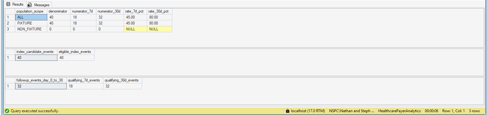

# Healthcare Payer Analytics Pipeline

A portfolio project modeling a synthetic North Carolina Medicaid managed-care analytics workflow from source ingestion through payer quality reporting.

## Current milestone — Quality Performance

Development is intentionally sequenced so the first complete business-facing milestone demonstrates a realistic quality-data workflow:

**synthetic source data → SQL Server raw/core model → FUH-style performance measure → quality analysis → planned Excel reconciliation → planned Power BI reporting**

The implemented SQL milestone includes:

- reproducible Microsoft SQL Server ingestion and a typed relational core model;
- payer/enrollment, encounter, condition, claim, provider, and organization relationships;
- a project-owned FUH-style behavioral-health performance measure for measurement year 2025;
- auditable index-event eligibility and enrollment logic;
- auditable follow-up-event qualification with explicit same-day handling;
- event-level denominator/numerator results and aggregate rates;
- payer/month, demographic, follow-up-timing, and open-gap analytical reporting;
- executable QA with deterministic fixture acceptance tests.

The controlled fixture benchmark is:

- denominator: **40**;
- 7-day numerator: **18**;
- 30-day numerator: **32**;
- 7-day rate: **45.00%**;
- 30-day rate: **80.00%**.



**Important interpretation:** all 40 current denominator events are deterministic controlled fixtures. The pinned non-fixture Synthea population produced **zero eligible FUH-style denominator events** under the v0.1 rules (A-016). The 45% and 80% rates are therefore acceptance-test results, not observed real-population performance findings.

The project does **not** reproduce licensed HEDIS specifications and does not claim certified HEDIS results. The FUH implementation is HEDIS-oriented/FUH-style for portfolio demonstration only.

## Implemented data scale

Current validated core counts for the pinned source package:

- members: 5,671;
- payers: 10;
- enrollment spans: 36,632;
- organizations: 1,662;
- providers: 1,662;
- encounters: 313,094;
- conditions: 194,647;
- claims: 573,681;
- claim diagnoses: 825,929;
- claim transactions: 5,220,492.

## Stack

- Python
- Microsoft SQL Server Developer Edition
- SQL Server Management Studio
- Git / GitHub
- Excel / Power Query — **planned next phase**
- Power BI Desktop — **planned next phase**

## Active schemas

- `raw`
- `core`
- `ref`
- `measure`

## FUH-style measure architecture

```text
ref.measure_definition / ref.measure_value_set
                       |
                       v
          measure.fuh_index_event_detail
                       |
                       v
        measure.fuh_followup_event_detail
                       |
                       v
             measure.fuh_measure_result
                /                 \
               v                   v
measure.fuh_measure_summary   analytical reporting views
```

See `sql/04_measure/fuh/README.md` for execution order and `docs/fuh_methodology.md` for implemented business rules and limitations.

## How to run

1. Follow the database/core rebuild order in `sql/02_core/README.md` after raw ingestion is available.
2. Run the Phase 3 reference and FUH measure files in the order documented in `sql/04_measure/fuh/README.md`.
3. Run `sql/05_tests/004_validate_fuh_index.sql` through `007_validate_phase3_closeout.sql`; the final closeout script must pass before results are treated as validated.

Additional local setup notes are in `docs/setup.md`.

## Current status

- Phase 0 — environment/setup: complete.
- Phase 1 — raw ingestion: complete.
- Phase 2 — typed core relational model: complete and validated.
- Phase 3 — performance-measure and quality-analytics SQL layer: **complete and validated**. Final closeout validation passed `T-FUH-095` through `T-FUH-110`.
- Next milestone work: Excel reconciliation, Power BI presentation, and portfolio publication.

The full project can later expand beyond this milestone, but unsupported domains are not manufactured inside the current Phase 3 implementation. In particular, the current measure layer does not claim official NCQA compliance, licensed value sets, principal-diagnosis-dependent readmission/transfer exclusions, pharmacy integration, physical-health integration, disability analysis, cultural-factor analysis, or regulatory submission capability.

Future expansion notes live under `docs/roadmap/v0.2-expanded-payer-platform/`.
